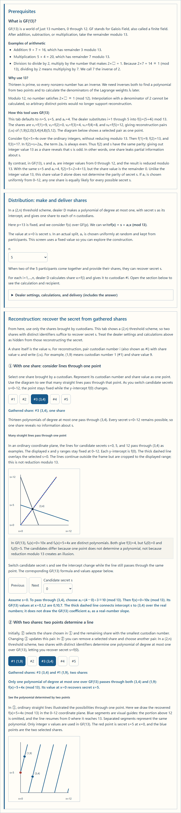
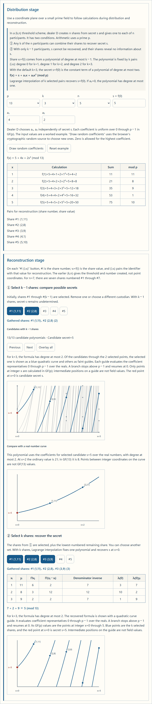
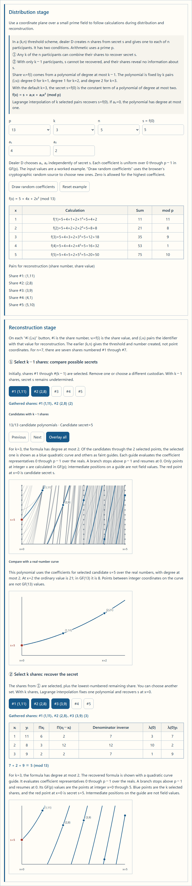
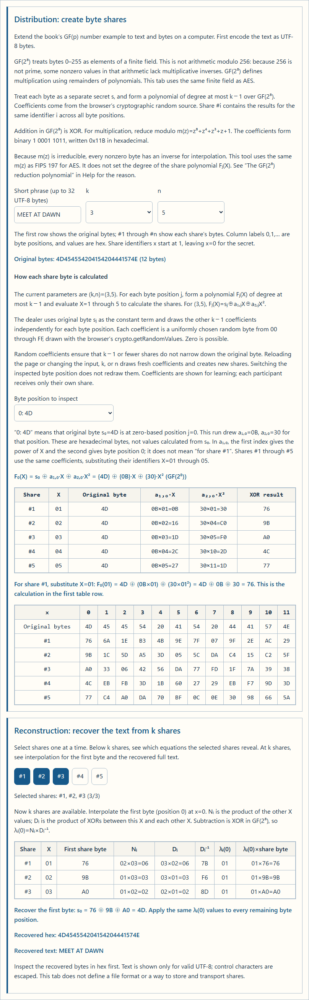
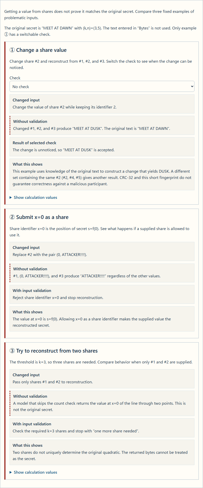

English · [日本語](README.md)

# ShamirSharing CipherLab - Shamir secret sharing with coordinate planes and bytes


[](https://ipusiron.github.io/shamir-sharing-cipherlab/)

**Day123 - 200 Security Tools with Generative AI**

ShamirSharing CipherLab is a teaching tool for trying Shamir secret sharing on coordinate planes and in byte tables. Begin with “Visualize (2, n)” to compare one share with two, then calculate a general threshold scheme in “Trace (k, n) by hand”. “Bytes” applies it to a short string, and “Pitfalls” examines invalid inputs and changed shares.

Shamir and Blakley independently proposed secret sharing schemes in 1979. This tool implements Shamir’s polynomial construction. Lagrange interpolation is its reconstruction calculation. Blakley’s geometric construction is outside the scope of the tool.[^blakley-visual]

[^blakley-visual]: [Blakley's 1979 scheme](https://pages.cs.wisc.edu/~cs812-1/Blakley1979.pdf) treats each share as a hyperplane and recovers the secret from the intersection of enough hyperplanes. The earlier [Day070 VisualCryptography CipherLab](https://github.com/ipusiron/visual-cryptography-cipherlab) implements [Naor and Shamir's 1994 visual cryptography](https://www.wisdom.weizmann.ac.il/~naor/PAPERS/vis.pdf): image shares are superimposed to reveal the image by eye. Both use multiple shares, but they are different constructions.

In Shamir’s (k,n) threshold scheme, n shares are made from secret s and given to n participants, one each. It has two conditions.

① Any k of the n participants can combine their shares to recover s.

② With only k−1 participants, s cannot be recovered, and their shares reveal no information about it. If the coefficients are drawn uniformly, including zero, every possible secret remains equally likely.

Use invented numbers for s in “Visualize (2, n)” and “Trace (k, n) by hand”, and a practice phrase in “Bytes”. Do not use this teaching tool to split or store passwords, seed phrases, or keys that you actually use. This tool does not provide share formats, printing, QR codes, or storage advice.

---

## 🌐 Demo

👉 **[Open ShamirSharing CipherLab](https://ipusiron.github.io/shamir-sharing-cipherlab/)**

Open it in a browser, or open the HTML directly with `file://`. Computation and input stay in the browser, with no external submission.

---

## 📸 Screenshots

These screenshots show light mode. Use the “◐” button at the top right to switch to dark mode.

**Visualize (2, n)**



**Trace (k, n) by hand**



**k−1 candidates**



**Bytes**



**Pitfalls**



The same five states in Japanese appear in the [Japanese README](README.md).
The byte table shows one set of coefficients used for the screenshots. Opening “Bytes” again draws new random coefficients and changes the share values.

## ✨ Features

| Step | Action | What you can see |
|---|---|---|
| Visualize (2, n) | Cycle through candidate secrets with one share, then add a second | Several lines through one point, then one polynomial fixed by two points |
| Trace (k, n) by hand | Distribute and reconstruct in GF(p), overlay k−1 candidates | Share calculations, Lagrange weights, and possible secrets |
| Bytes | Split a short UTF-8 phrase in GF(2⁸) and recover with k shares | A polynomial per byte, XOR, and a recovery calculation that responds to the number selected |
| Pitfalls | Compare tampering, x=0, and too few shares | The differences among no check, CRC-32, and an embedded fingerprint |

Following the book’s notation, `D` is the dealer, `s` the secret, and `vᵢ=f(i)` share number `i`. The `(k,n)` threshold scheme creates n shares and recovers s from any k of them. Choose a prime `p>max(s,n)` for arithmetic. The polynomial has degree at most k−1: degree 0 for k=1, degree 1 for k=2, and degree 2 for k=3. The default `k=3` uses `f(x)=s+a₁x+a₂x² (mod p)` and recovers `s=f(0)` by Lagrange interpolation.

In the book, the share is the value `vᵢ`. On this tool’s `#i (i,vᵢ)` button, `#i` is its identifier and the parentheses contain the identifier and value used for reconstruction. The earlier `(k,n)` gives the threshold and total number of shares, not point coordinates. For example, `n=7` creates seven shares numbered `#1` through `#7`.

In the distribution stage, the table shows the substituted expression, its sum, and its value modulo p for each share. Beneath the table, reconstruction pairs `(i,vᵢ)` appear in identifier order. With `n=7`, the tool creates shares `#1` through `#7`; changing coefficients or p updates their values.

The default example in “Trace (k, n) by hand” is `p=13, k=3, n=5, f(x)=5+4x+2x²`. Its reconstruction pairs are `(1,11), (2,8), (3,9), (4,1), (5,10)`. For shares #1, #2, and #3, the weights are `(3,10,1)` and their contributions are `(7,2,9)`. Their sum modulo 13 recovers secret `5`. Two shares leave 13 candidates.

Coefficients are allowed to be zero, so the polynomial has degree *at most* k−1. With `k=1`, every share is simply the secret: copying instead of splitting.

### Why begin with (2, n)?

GF(13) is a finite field with thirteen integer values, 0–12. Add, subtract, and multiply modulo 13; division by a nonzero number means multiplication by its inverse. Because 13 is prime, every nonzero value has an inverse. “Visualize (2, n)” fixes p=13 and uses `f(x)=s+a₁x (mod 13)`. Its prerequisite section contrasts shares calculated over ordinary integers with shares calculated in GF(13).

The first tab starts with `p=13, n=5, s=5, a₁=4` and makes shares from `f(x)=5+4x (mod 13)`. During “Distribution”, dealer `D` calculates `vᵢ=f(i)` and gives one share to each custodian. Open the disclosure to follow the calculations and recipients, from `v₁=f(1)=(5+4×1) mod 13=9` to `v₅=f(5)=(5+4×5) mod 13=12`.

“Reconstruction” initially selects custodian #3’s pair `(3,4)`. The share itself is the value `v₃=4`. For reconstruction, pair identifier `i` (shown as `#i`) with share value `vᵢ` and write `(i,vᵢ)`. For example, `(1,9)` combines custodian #1 with share value 9. With only #3’s point, the alternative `s=0, a₁=10` also fits. Every candidate `s=0…12` has a corresponding polynomial. Uniformly chosen coefficients leave all candidates equally likely. Add custodian #1’s `(1,9)` and the polynomial is uniquely `f(x)=5+4x (mod 13)`, recovering `s=f(0)=5`.

The dealer can change `s` and `a₁` inside a collapsed section. A participant with one share should be considered unaware of those settings. The coordinate plane starts at zero: horizontal x is the share identifier and vertical y is the share value. Hover over a point to read its `(x,y)` coordinates.

The one-share diagram draws three ordinary straight lines through `(3,4)`. Each intersects the y-axis at `f(0)`, a candidate secret `s`. The intersections are `0`, `5`, and `12`, showing that one point does not determine a line.

In GF(13), `f₀(x)=10x` and `f₅(x)=5+4x` are distinct polynomials. Both give `f(3)=4`, but `f₀(0)=0` and `f₅(0)=5`. One point alone does not determine the polynomial. For a selected candidate `s`, calculate `a₁=(y−s)÷x (mod 13)` to find its formula. With `s=0`, `f(x)=10x (mod 13)` gives `0,10,7` at `x=0,1,2`. The line in the interface helps illustrate the relation between a point and its intercept. GF(13) can be evaluated only at integer `x=0…12`; intermediate positions on the line are not field values.

## 📚 Follow 『暗号技術のすべて』 alongside the tool

Follow section 9.2 (pp. 652–661) of 『暗号技術のすべて』 while entering its worked examples in the tool. Start with the linear (2,n) scheme, then trace share generation and interpolation for a general (k,n) threshold. The book’s (3,5) example can also be reproduced.

| Book pages | Try in the tool |
|---|---|
| 652–654 | Try the linear (2,n) construction in the first tab: one share leaves 13 candidate secrets, while two fix one. Open the distribution details to see dealer `D` hand one share `vᵢ=f(i)` to each participant. |
| 655–657 | Match the book’s points `(a,A),(b,B),(c,C)` with `(xᵢ,yᵢ)` and weights `λᵢ(0)` in “Trace (k, n) by hand”. Compare two selected shares, which leave candidates, with the reconstruction from three. |
| 658–659 | Enter the book’s example: `p=17, k=3, n=5, s=13, a₁=10, a₂=2`. The shares are `f(1)…f(5)=8,7,10,0,11`. Select `#1, #3, #5` and recover `s=13`. |
| 660–661 | Use “Pitfalls” to explore incorrect shares and verification. The book’s VSS extensions have different capabilities from this tool’s CRC and fingerprint models. |

The tool starts with a smaller GF(13) example. Use “Reset example” after trying the values from the book.

## 📖 How to use it

1. Open the distribution details in “Visualize (2, n)” to see dealer D calculate and hand out shares `v₁…vₙ`. In reconstruction step ①, select one share and vary the intercept of a line through its point. In step ②, add a second share to fix the polynomial and secret.
2. In “Trace (k, n) by hand”, set `p, k, n, s, a₁…` and read the substituted expressions and share values in the distribution table. Enter coefficients or use “Draw random coefficients”.
3. In reconstruction step ①, select `k−1` shares and cycle through candidate secrets or press “Overlay all”. In step ②, select `k` shares to see the Lagrange interpolation table and `f(0)`. Distinguish finite-field values at integer x from the real-number curve drawn as a guide.
4. In “Bytes”, enter up to 32 UTF-8 bytes and split them with `2≤k≤n≤8`. Select a byte position to inspect its coefficients and share values. In reconstruction, add shares from zero upward and compare the equations below k with the interpolation table at k.
5. In “Pitfalls”, inspect a changed share, x=0, and too few shares. Switch the check in the first card. The cards use fixed `MEET AT DAWN` data and do not respond to text entered in “Bytes”.

Open “?” at the top right for instructions, use cases, the fixed GF(2⁸) multiplication example, and input and storage information. The “Theory” disclosure contains the threshold argument and sources.

### Processing added in “Bytes”

The book explains Shamir’s scheme through numbers in GF(p). “Bytes” extends the idea to a short string on a computer. The tab explains each stage on screen.

1. Convert the input to UTF-8. A Japanese character can occupy several bytes, so the 32-byte limit counts bytes rather than characters.
2. Build a separate polynomial `Fⱼ(X)` from the original byte `sⱼ` at each byte position `j`. Draw independent coefficients for each column with `crypto.getRandomValues`. Share `#i` collects the results evaluated at identifier `i` across all positions. Select a byte position in the interface to inspect that run’s coefficients and results for `#1` through `#n`.
3. Add shares one at a time during reconstruction. With the default k=3, the unknowns for the first byte are `s₀, a₁,₀, a₂,₀`. One share gives one equation; two give two. In either case, every value 00–FF is still possible for `s₀`. Once three shares are selected, calculate `λᵢ(0)` from their identifiers and XOR its products with the share bytes to recover the first byte. Apply the same weights to every other byte position.
4. Read the recovered bytes in hex first. Display them as text only if they form valid UTF-8, and escape control characters, so the text view does not hide the byte result.

GF(2⁸) addition is XOR, and multiplication uses the irreducible polynomial `z⁸+z⁴+z³+z+1`. Help contains the fixed `{57}×{13}={FE}` example with eight multiplication steps and an explanation of the display-only log/exp table. This example does not change with the random coefficients drawn for shares. The tool does not specify a share file format or a way to store and transfer shares.

### Why 0x11B appears

For `(k,n)=(3,5)`, each byte position `j` gets a polynomial `Fⱼ(X)=sⱼ⊕a₁,ⱼX⊕a₂,ⱼX²`. The original byte is `sⱼ`; `a₁,ⱼ` and `a₂,ⱼ` are independently random coefficients. Evaluating at `X=1,2,3,4,5` produces column `j` of shares `#1` through `#5`. Here `k=3` sets the maximum degree of `Fⱼ` to two, and `n=5` sets the number of identifiers to evaluate. The displayed share bytes change on each generation because the coefficients are redrawn.

For a fixed worked example, let `s₀={4D}`, `a₁,₀={57}`, and `a₂,₀={13}`. For column zero of `#2`, substitute `X={02}` and `X²={04}`: `{57}·{02}={AE}` and `{13}·{04}={4C}`, so `{4D}⊕{AE}⊕{4C}={AF}`. For `#4`, `{57}·{04}={47}` and `{13}·{10}={2B}`, giving `{4D}⊕{47}⊕{2B}={21}`. These coefficients illustrate the method; the interface draws fresh random ones.

The share polynomial `Fⱼ(X)` is distinct from the reduction polynomial `m(z)=z⁸+z⁴+z³+z+1` used for byte multiplication. `X` is the share identifier. The symbol `z` represents a byte as a binary polynomial: for example, `0x57` represents `z⁶+z⁴+z²+z+1`. When calculating `X²` or `a₂,ⱼX²` in `Fⱼ(2)`, reduce the byte products modulo `m(z)`. Do not divide the whole share polynomial `Fⱼ(X)` by `m(z)`.

The nonzero coefficient positions of `m(z)` are 8, 4, 3, 1, and 0. Writing its coefficients from degree eight to zero gives `1 0001 1011₂`, or `0x11B` in hexadecimal. When shifting an eight-bit value left overflows, use `z⁸≡z⁴+z³+z+1 (mod m)`. The low eight bits of the right-hand side are `0x1B`, the reduction constant visible in the implementation.

The reduction polynomial must be irreducible of degree eight. Then the 256 remainders form a field, every nonzero byte has an inverse, and Lagrange interpolation can divide by its denominators. As two is the only prime factor of eight, the two conditions `z²⁵⁶≡z (mod m)` and `gcd(m,z¹⁶−z)=1` establish irreducibility. In GF(2), subtraction is XOR: `z¹⁶ mod m=0x5E`, so `z¹⁶−z=0x5C`. The Euclidean remainders are `0x37→0x05→0x01`, giving gcd 1.

Other irreducible polynomials of degree eight exist. This tool selects this one to match the GF(2⁸) multiplication specified for AES in [NIST FIPS 197, section 4.2](https://nvlpubs.nist.gov/nistpubs/FIPS/NIST.FIPS.197-upd1.pdf). It does not use AES encryption to create shares.

## 🔬 Method and limits

In GF(p), `λᵢ(0) = Πⱼ≠ᵢ xⱼ/(xⱼ−xᵢ)` and `s = Σᵢ λᵢ(0)yᵢ`. GF(2⁸) uses the same interpolation with XOR for addition and subtraction. The previous section derives the relationship between byte multiplication and `0x11B`. The display-only log/exp table uses generator `{03}`, as in the SLIP-39 reference implementation. The bundled tests check that `{03}` has order 255 and `{02}` has order 51.

Actual splitting and reconstruction use eight shifts and masks, without table lookups. [CVE-2023-25000](https://osv.dev/vulnerability/GO-2023-1709) is an example where table lookup timing mattered. JavaScript execution does not guarantee constant time. This browser implementation is for teaching, not operational secret sharing.

CRC-32 detects transcription errors, but a participant who changes a share can recompute its CRC. A four-byte prefix of SHA-256 included in the shared secret detects an incorrect reconstruction with high probability, but cannot identify the bad share. Without knowing the original secret, a cheater can choose an offset but cannot target an arbitrary replacement phrase. The model can show `DAWN→DUSK` because the original phrase is visible to the audience.

Each theory section in the interface separates primary and secondary sources. Shamir’s paper appeared in *Communications of the ACM* 22(11), 612–613 (1979), [DOI:10.1145/359168.359176](https://doi.org/10.1145/359168.359176). Blakley’s original paper is [*Safeguarding Cryptographic Keys* (1979)](https://pages.cs.wisc.edu/~cs812-1/Blakley1979.pdf). For interpolation, see [HAC 12.71](https://cacr.uwaterloo.ca/hac/about/chap12.pdf) and IPUSIRON’s Japanese-language book 『暗号技術のすべて』, section 9.2 (pp. 652–661). Tompa and Woll’s full text was not checked; bibliographies disagree between 1988 1(2) and 1989 1(3).

## 🔄 Day070 and prior work

| Aspect | [Day070 VisualCryptography CipherLab](https://github.com/ipusiron/visual-cryptography-cipherlab) | Day123 ShamirSharing CipherLab |
|---|---|---|
| Scheme | Naor–Shamir visual cryptography (1994) | Shamir threshold sharing (1979) |
| Secret | Black-and-white image pixels | Numbers in GF(p) and bytes in GF(2⁸) |
| Reconstruction | Overlay two images and look | Compute Lagrange interpolation |
| Thresholds shown | (2,2) hands-on | Vary (k,n) and draw k−1 candidates |
| Share size | Pixels expand and contrast falls when overlaid | Same size as the secret (ideal) |

| Aspect | Prior examples within the research scope | Added experience here |
|---|---|---|
| Visualization | Videos, slides, and a Wolfram graph | Overlay candidate secrets and compare them with the recovered polynomial |
| Manual arithmetic | codex32’s GF(32) paper tool | Trace small GF(p) interpolation, then move to GF(2⁸) |
| Pitfalls | Many implementations reject or check invalid inputs | Place unsafe models beside guarded functions |

The prior-work survey was not exhaustive. Day070 shares images; Day123 shares numbers and bytes using a different scheme.

## 🎯 Use cases

Ways of using this tool in particular:

- Mathematics class: students fix `(1,11)` and `(2,8)` and overlay 13 candidates. They can see why no candidate gets priority.
- Introduction to finite fields: compare integer values `21,35` of `f(x)=5+4x+2x²` with GF(13) values `8,9`. Students see when remainders disclose the secret.
- Code review exercise: inspect why the coefficient draw includes zero and why x=0 must not be accepted as a share identifier.
- Puzzle or CTF design: an author makes a puzzle with public sample values; participants compute secret `5` from `λ=(3,10,1)`. No real credentials are used.
- Programming lesson: passing two shares to the unsafe function returns wrong bytes beginning `2DB1…`. Students can design threshold and UTF-8 checks.

It also works as a companion to section 9.2 (pp. 652–661) of 『暗号技術のすべて』, a comparison with Day070’s visual cryptography, an entry to fingerprinting through [Day118 SHA-256 Byte Inspector](https://github.com/ipusiron/sha256-byte-inspector), and a bridge to information-theoretic secrecy in [Day029 OTP Animation](https://github.com/ipusiron/otp-animation).

## 🔒 Inputs and implementation cautions

- Storage: Only language and theme are saved. Phrases and coefficients never go into localStorage or the URL.
- Network: Application computation makes no external request, and CSP sets `connect-src 'none'`.
- Input: At most 32 UTF-8 bytes; GF(p) values range from 0 to p−1. IME composition does not trigger recomputation.
- Recovery: The guarded interpolation rejects x=0, duplicate x, fewer than k shares, and inconsistent lengths. Unsafe models live in a separate file.
- Limit: This teaching tool does not prove that shares from different split runs belong together or identify a dishonest participant.

## 🧪 Tests

Run `npm test` with Node.js 22 or later. No package installation is required. GitHub Actions runs the suite on push and pull request. With Python Playwright available, `python test/interface.browser.py` checks `file://` behavior in Chromium and Firefox at 320, 390, and 1280 pixels.

| Area | Main checks |
|---|---|
| A GF(2⁸) | All 65,536 multiplication pairs, two FIPS 197 examples, 255 inverses, generator orders |
| B GF(p) | Five default shares, three λ sets, 13 candidates, coefficient sampling range, integer values, k=1 |
| C Split and combine | Known shares from fixed test randomness, all ten 3-of-5 subsets, random round trips |
| D Pitfalls | Tampering, CRC, fingerprint, x=0, too few shares, every fixed vector field |
| E Static and UI | CSP, storage keys, forbidden APIs, bilingual dictionary, SHA-256 copy, viewport and interactions |

Expected values come from `test/vectors.json`. Its test-only random byte number i is `(37·i+11) mod 256`. The interface uses `crypto.getRandomValues` for splitting.

## 📁 Directory structure

The text after `#` explains each file. The local `.work/` directory is excluded from Git.

```text
|-- .github/workflows/test.yml # Node 22 CI
|-- LICENSE # MIT license
|-- README.md # Japanese documentation and hub YAML
|-- README.en.md # English documentation
|-- package.json # Test command
|-- index.html # Four-tab interface and CSP
|-- style.css # Coordinate-plane styling and layout
|-- messages.js # Japanese and English dictionary
|-- app.js # DOM, reconstruction table, candidate diagrams and real-number curve
|-- intro.js # (2,n) line and candidate diagrams
|-- gf-core.js # Pure field and interpolation functions
|-- pitfalls.js # Deliberately unsafe models and checks
|-- sha256-core.js # SHA-256 copy from Day118
|-- test/core.test.js # Known-value and arithmetic tests
|-- test/structure.test.js # CSP and dictionary static tests
|-- test/readme.test.js # Bilingual README and file list tests
|-- test/interface.browser.py # file:// and UI browser tests
|-- test/vectors.json # Expected values copied from the reference
|-- assets/ja/light/hand.png # Japanese light hand calculation
|-- assets/ja/light/intro.png # Japanese light (2,n) introduction
|-- assets/ja/light/bytes.png # Japanese light byte table
|-- assets/ja/light/pitfalls.png # Japanese light pitfall cards
|-- assets/ja/light/candidates.png # Japanese light candidates
|-- assets/ja/dark/hand.png # Japanese dark hand calculation
|-- assets/ja/dark/intro.png # Japanese dark (2,n) introduction
|-- assets/ja/dark/bytes.png # Japanese dark byte table
|-- assets/ja/dark/pitfalls.png # Japanese dark pitfall cards
|-- assets/ja/dark/candidates.png # Japanese dark candidates
|-- assets/en/light/hand.png # English light hand calculation
|-- assets/en/light/intro.png # English light (2,n) introduction
|-- assets/en/light/bytes.png # English light byte table
|-- assets/en/light/pitfalls.png # English light pitfall cards
|-- assets/en/light/candidates.png # English light candidates
|-- assets/en/dark/hand.png # English dark hand calculation
|-- assets/en/dark/intro.png # English dark (2,n) introduction
|-- assets/en/dark/bytes.png # English dark byte table
|-- assets/en/dark/pitfalls.png # English dark pitfall cards
|-- assets/en/dark/candidates.png # English dark candidates
```

## 💻 Requirements

The interface was checked in recent Chromium and Firefox. It works under `file://`. Screenshots and browser tests used Python Playwright. The application itself uses no external library, WebAssembly, or external font.

## 📄 License

MIT License. `sha256-core.js` was copied byte for byte, including its MIT notice, from the same author’s Day118 tool.

---

## 🛠️ About this tool

This tool was created as part of the “200 Security Tools with Generative AI” project. The project makes and publishes security-related learning tools with help from AI.

🔗 [About the project](https://akademeia.info/?page_id=44607)
