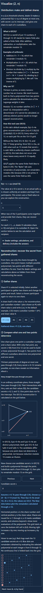
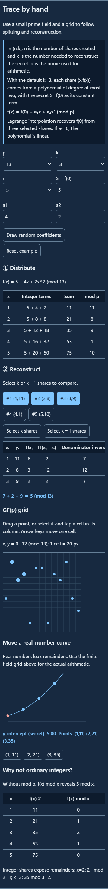
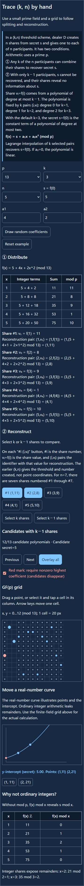
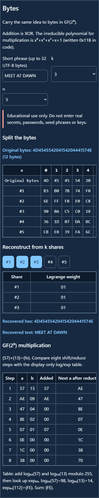
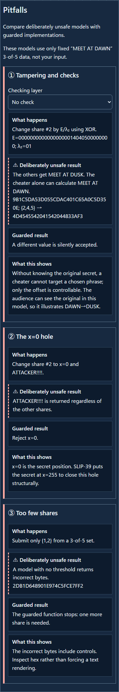

English · [日本語](README.md)

# ShamirSharing CipherLab - Shamir secret sharing on grids and bytes


[](https://ipusiron.github.io/shamir-sharing-cipherlab/)

**Day123 - 200 Security Tools with Generative AI**

ShamirSharing CipherLab is a hands-on teaching tool for Shamir secret sharing, using a grid, byte tables, and deliberately unsafe models. Start with “Visualize (2, n)” to compare one and two participants, then move to “Trace (k, n) by hand” for the general threshold. Shamir and Blakley independently proposed secret sharing in 1979. This tool implements Shamir’s polynomial scheme with Lagrange interpolation; it does not implement Blakley’s geometric scheme.

In Shamir’s (k,n) threshold scheme, n shares are made from secret s and given to n participants, one each. It has two conditions.

① Any k of the n participants can combine their shares to recover s.

② With only k−1 participants, s cannot be recovered, and their shares reveal no information about it. The grid shows how a polynomial fits every possible secret.

Use invented numbers for s in “Visualize (2, n)” and “Trace (k, n) by hand”, and a practice phrase in “Bytes”. Do not use this teaching tool to split or store passwords, seed phrases, or keys that you actually use. This tool does not provide share formats, printing, QR codes, or storage advice.

---

## 🌐 Demo

👉 **[Open ShamirSharing CipherLab](https://ipusiron.github.io/shamir-sharing-cipherlab/)**

Open it in a browser, or open the HTML directly with `file://`. Computation and input stay in the browser, with no external submission.

---

## 📸 Screenshots

| State | Light | Dark |
|---|---|---|
| Visualize (2, n) |  |  |
| Trace (k, n) by hand |  |  |
| k−1 candidates |  |  |
| Bytes |  |  |
| Pitfalls |  |  |

The same five states in Japanese appear in the [Japanese README](README.md).

## ✨ Features

| Step | Action | What you can see |
|---|---|---|
| Visualize (2, n) | Cycle through candidate secrets with one share, then add a second | Thirteen polynomials of degree at most one through one point, then one through two points |
| Trace (k, n) by hand | Distribute in GF(p), reconstruct with k shares, overlay k−1 candidates | Lagrange weights and one polynomial per candidate secret |
| Bytes | Split a short UTF-8 phrase in GF(2⁸) and recover with k shares | A polynomial per byte, XOR, and eight shift/reduce steps |
| Pitfalls | Compare tampering, x=0, and too few shares | The differences among no check, CRC-32, and an embedded fingerprint |

Following the book’s notation, `D` is the dealer, `s` the secret, and `vᵢ=f(i)` share number `i`. The `(k,n)` threshold scheme creates n shares and recovers s from any k of them. Choose a prime `p>max(s,n)` for arithmetic. The polynomial has degree at most k−1: degree 0 for k=1, degree 1 for k=2, and degree 2 for k=3. The default `k=3` uses `f(x)=s+a₁x+a₂x² (mod p)` and recovers `s=f(0)` by Lagrange interpolation.

In the book, the share is the value `vᵢ`. On this tool’s `#i (i,vᵢ)` button, `#i` is its identifier and the parentheses contain the identifier and value used for reconstruction. The earlier `(k,n)` gives the threshold and total number of shares, not point coordinates. For example, `n=7` creates seven shares numbered `#1` through `#7`.

Below the “① Distribute” table, each line shows share value `vᵢ=f(i)` and the reconstruction pair `(i,vᵢ)=(i,f(i))=(i, substituted expression mod p)`. Choosing `n=7` shows seven lines; changing coefficients or `p` updates them.

The default example in “Trace (k, n) by hand” is `p=13, k=3, n=5, f(x)=5+4x+2x²`. Its reconstruction pairs are `(1,11), (2,8), (3,9), (4,1), (5,10)`. For {1,2,3}, the weights are `(3,10,1)`, the weighted terms are `(7,2,9)`, and the secret is `5`. Two shares leave 13 candidates. Forcing the highest coefficient to be nonzero removes candidate `s=1`.

Coefficients are allowed to be zero, so the polynomial has degree *at most* k−1. With `k=1`, every share is simply the secret: copying instead of splitting.

### Why begin with (2, n)?

GF(13) is a finite field with 13 values, 0–12. Add, subtract, and multiply modulo 13; division by a nonzero number means multiplication by its inverse. Because 13 is prime, every nonzero value has an inverse. The introductory tab now explains arithmetic examples, why a prime is needed, what leaks with ordinary integers, and how GF(2⁸) differs.

The first tab starts with `p=13, n=5, s=5, a₁=4` and makes shares from `f(x)=5+4x (mod 13)`. During “Distribution”, dealer `D` calculates `vᵢ=f(i)` and gives one share to each custodian. Open the disclosure to follow the calculations and recipients, from `v₁=f(1)=(5+4×1) mod 13=9` to `v₅=f(5)=(5+4×5) mod 13=12`.

During “Reconstruction”, start with custodian #1’s share. A share itself is the value `vᵢ`. For reconstruction, pair custodian number `i` (shown as `#i`) with share value `vᵢ` and write `(i,vᵢ)`. In the default example, `(1,9)` means custodian number 1 (`#1`) and share value 9. With this one point, the alternative `s=0, a₁=9` also fits. Every candidate `s=0…12` has a corresponding polynomial. Uniformly chosen coefficients leave all candidates equally likely. Add custodian #2’s `(2,0)` and the polynomial is uniquely `f(x)=5+4x (mod 13)`, recovering `s=f(0)=5`.

The dealer can change `s` and `a₁` inside a collapsed section. A participant with one share should be considered unaware of those settings. Both grids start at zero: the bottom-left cell is `(0,0)`, with `x` increasing to the right and `y` increasing upward. Hover over a cell or point to see its `(x,y)` coordinates. The grids show finite-field points, so they do not connect them as a continuous real-number line.

Under “② Compare what one and two points determine”, three straight lines through `(1,9)` first appear in an ordinary coordinate plane. Each line intersects the y-axis at `f(0)`, a candidate secret `s`. The intersections are `0`, `5`, and `12`, showing that one point does not determine a line.

In GF(13), `f₀(x)=9x` and `f₅(x)=5+4x` are also distinct polynomials. Both give `f(1)=9`, but `f₀(0)=0` and `f₅(0)=5`. Multiple candidates exist because one point does not determine a polynomial; reduction modulo 13 does not merely make one line look like several. For a chosen candidate `s`, calculate `a₁=(y−s)÷x (mod 13)` to get a polynomial through the point. With `s=0`, `f(x)=9x (mod 13)` gives `0,9,5` at integer `x=0,1,2`. Continue through `x=12` to place the blue dots. Red rings at `x=0` mark the 13 remaining candidate secrets. No continuous line is folded back into the grid. The GF(13) introduction in this tab uses the same `f(x)=5+4x` and five shares.

## 📚 Follow 『暗号技術のすべて』 alongside the tool

Section 9.2 (pp. 652–661) and the two number tabs make a useful pair. Begin with a linear polynomial in (2,n), then try interpolation and reconstruction for a general (k,n) threshold. Lagrange interpolation is Shamir’s reconstruction calculation, not a separate secret-sharing scheme.

| Book pages | Try in the tool |
|---|---|
| 652–654 | Try the book’s linear (2,n) explanation in “Visualize (2, n)”: one participant leaves 13 possible secrets, while two fix one. Then check the `(k,n)` threshold, dealer `D`, secret `s`, and shares `vᵢ=f(i)` under “① Distribute”. |
| 655–657 | Compare the book’s three points `(a,A),(b,B),(c,C)` with the selected `(xᵢ,yᵢ)` and weights `λᵢ(0)` under “② Reconstruct”. Select only two shares and overlay the remaining candidates on the grid. |
| 658–659 | Enter the book’s example: `p=17, k=3, n=5, s=13, a₁=10, a₂=2`. The shares are `f(1)…f(5)=8,7,10,0,11`. Select `#1, #3, #5` and recover `s=13`. |
| 660–661 | Use “Pitfalls” to explore incorrect shares and verification. The book’s VSS extensions have different capabilities from this tool’s CRC and fingerprint models. |

The tool starts with a smaller GF(13) example. Use “Reset example” after trying the values from the book.

## 📖 How to use it

1. In “Visualize (2, n)”, start with one share and cycle through candidate secrets. Every candidate has a polynomial of degree at most one through the point. Add a second participant to fix one polynomial and one secret. Dealer settings are collapsed to distinguish them from information given to participants.
2. In “Trace (k, n) by hand”, vary `p, k, n, s, a₁…` and read the distribution and reconstruction tables. Enter coefficients or draw them with cryptographic randomness.
3. Select `k−1 shares`. Advance one candidate at a time or overlay all of them. Toggle the red nonzero-leading-coefficient switch to see a candidate vanish.
4. Drag a grid point, or select it and tap another cell in the same column. Clicking a point focuses it, and up and down arrow keys move it one cell. With k shares, the table and `Δs=λᵢ(0)·Δ (mod p)` update together. With fewer than k−1 shares, the curve is not unique; faint points show one example from the current polynomial.
5. Drag points on the real-number curve to change its y-intercept. With k−1 points, you can move the intercept and still pass through them. After using the curve to see the relationship between points and intercept, use the integer table to observe leaked remainders, then compare with the finite-field grid.
6. In “Bytes”, enter up to 32 UTF-8 bytes. Split with `2≤k≤n≤8`, select k shares, and recover. Hex is always shown; text appears only for valid UTF-8, with controls escaped.
7. In “Pitfalls”, switch the checking layer. All three cards use fixed `MEET AT DAWN` data rather than your input.

Open “?” at the top right for instructions, use cases, and input and storage information. The theory sections and sources are in a collapsible section of Help.

### Processing added in “Bytes”

The book explains Shamir’s scheme through numbers in GF(p). “Bytes” extends the idea to a short string on a computer. The tab explains each stage on screen.

1. Convert the input to UTF-8. A Japanese character can occupy several bytes, so the 32-byte limit counts bytes rather than characters.
2. Treat each byte as a separate secret `s` and build a polynomial over GF(2⁸). Draw coefficients with `crypto.getRandomValues`. Share `#i` is the sequence of results at identifier `i` across all byte positions. The table shows each byte in hex.
3. Select k shares with distinct identifiers. At each byte position, multiply a share byte by its `λᵢ(0)` weight in GF(2⁸), then XOR the products to recover that byte. Reconstruction stops with fewer than k shares.
4. Read the recovered bytes in hex first. Display them as text only if they form valid UTF-8, and escape control characters, so the text view does not hide the byte result.

GF(2⁸) addition is XOR. Multiplication uses the irreducible polynomial `x⁸+x⁴+x³+x+1`. Compare the eight-step multiplication with the display-only log/exp table further down the tab. This teaching tool does not specify a share file format or a way to store and transfer shares.

## 🔬 Method and limits

In GF(p), `λᵢ(0) = Πⱼ≠ᵢ xⱼ/(xⱼ−xᵢ)` and `s = Σᵢ λᵢ(0)yᵢ`. GF(2⁸) uses the same interpolation with XOR for addition and subtraction. Its irreducible polynomial is `x⁸+x⁴+x³+x+1`; `0x11B` is the code notation. The display-only log/exp table uses generator `{03}`, as in the SLIP-39 reference implementation. The bundled tests check that `{03}` has order 255 and `{02}` has order 51.

Actual splitting and reconstruction use eight shifts and masks, without table lookups. [CVE-2023-25000](https://osv.dev/vulnerability/GO-2023-1709) is an example where table lookup timing mattered. JavaScript execution does not guarantee constant time. This browser implementation is for teaching, not operational secret sharing.

CRC-32 detects transcription errors, but a participant who changes a share can recompute its CRC. A four-byte prefix of SHA-256 included in the shared secret detects an incorrect reconstruction with high probability, but cannot identify the bad share. Without knowing the original secret, a cheater can choose an offset but cannot target an arbitrary replacement phrase. The model can show `DAWN→DUSK` because the original phrase is visible to the audience.

Each theory section in the interface separates primary and secondary sources. Shamir’s paper appeared in *Communications of the ACM* 22(11), 612–613 (1979), [DOI:10.1145/359168.359176](https://doi.org/10.1145/359168.359176). Blakley’s original paper is [*Safeguarding Cryptographic Keys* (1979)](https://pages.cs.wisc.edu/~cs812-1/Blakley1979.pdf). For interpolation, see [HAC 12.71](https://cacr.uwaterloo.ca/hac/about/chap12.pdf) and IPUSIRON’s Japanese-language book 『暗号技術のすべて』, section 9.2 (pp. 652–661). Tompa and Woll’s full text was not checked; bibliographies disagree between 1988 1(2) and 1989 1(3).

## 🔄 Day070 and prior work

| Aspect | [Day070 VisualCryptography CipherLab](https://github.com/ipusiron/visual-cryptography-cipherlab) | Day123 ShamirSharing CipherLab |
|---|---|---|
| Scheme | Naor–Shamir visual cryptography (1994) | Shamir threshold sharing (1979) |
| Secret | Black-and-white image pixels | Numbers in GF(p) and bytes in GF(2⁸) |
| Reconstruction | Overlay two images and look | Compute Lagrange interpolation |
| Thresholds shown | (2,2) hands-on | Vary (k,n) and draw k−1 candidates |
| Share size | Pixels expand and contrast falls when overlaid | Same size as the secret (ideal) |

| Aspect | Prior examples within the research scope | Added experience here |
|---|---|---|
| Visualization | Videos, slides, and a Wolfram graph | Overlay candidates on a grid and move points |
| Manual arithmetic | codex32’s GF(32) paper tool | Trace small GF(p) interpolation, then move to GF(2⁸) |
| Pitfalls | Many implementations reject or check invalid inputs | Place unsafe models beside guarded functions |

The prior-work survey was not exhaustive. Day070 shares images; Day123 shares numbers and bytes using a different scheme.

## 🎯 Use cases

Ways of using this tool in particular:

- Mathematics class: students fix `(1,11)` and `(2,8)` and overlay 13 candidates. They can see why no candidate gets priority.
- Introduction to finite fields: compare integer values `21,35` of `f(x)=5+4x+2x²` with GF(13) values `8,9`. Students see when remainders disclose the secret.
- Code review exercise: a reviewer toggles the nonzero-leading-coefficient rule, watches `s=1` disappear, and checks the coefficient generation policy.
- Puzzle or CTF design: an author makes a puzzle with public sample values; participants compute secret `5` from `λ=(3,10,1)`. No real credentials are used.
- Programming lesson: passing two shares to the unsafe function returns wrong bytes beginning `2DB1…`. Students can design threshold and UTF-8 checks.

It also works as a companion to section 9.2 (pp. 652–661) of 『暗号技術のすべて』, a comparison with Day070’s visual cryptography, an entry to fingerprinting through [Day118 SHA-256 Byte Inspector](https://github.com/ipusiron/sha256-byte-inspector), and a bridge to information-theoretic secrecy in [Day029 OTP Animation](https://github.com/ipusiron/otp-animation).

## 🔒 Inputs and implementation cautions

- Storage: Only language and theme are saved. Phrases and coefficients never go into localStorage or the URL.
- Network: Application computation makes no external request, and CSP sets `connect-src 'none'`.
- Input: At most 32 UTF-8 bytes; GF(p) values range from 0 to p−1. IME composition does not trigger recomputation.
- Recovery: The guarded interpolation rejects x=0, duplicate x, fewer than k shares, and inconsistent lengths. Unsafe models live in a separate file.
- Limit: This teaching tool does not prove that shares from different split runs belong together or identify a dishonest participant.

## 🧪 Tests

Run `npm test` with Node.js 22 or later. No package installation is required. GitHub Actions runs the suite on push and pull request. With Python Playwright available, `python test/interface.browser.py` checks `file://` behavior in Chromium and Firefox at 320, 390, and 1280 pixels.

| Area | Main checks |
|---|---|
| A GF(2⁸) | All 65,536 multiplication pairs, two FIPS 197 examples, 255 inverses, generator orders |
| B GF(p) | Five default shares, three λ sets, 13 candidates, removed `s=1`, integer values, `λᵢ(0)·Δ`, k=1 |
| C Split and combine | Known shares from fixed test randomness, all ten 3-of-5 subsets, random round trips |
| D Pitfalls | Tampering, CRC, fingerprint, x=0, too few shares, every fixed vector field |
| E Static and UI | CSP, storage keys, forbidden APIs, bilingual dictionary, SHA-256 copy, viewport and interactions |

Expected values come from `test/vectors.json`. Its test-only random byte number i is `(37·i+11) mod 256`. The interface uses `crypto.getRandomValues` for splitting.

## 📁 Directory structure

The text after `#` explains each file. The local `.work/` directory is excluded from Git.

```text
|-- .github/workflows/test.yml # Node 22 CI
|-- LICENSE # MIT license
|-- README.md # Japanese documentation and hub YAML
|-- README.en.md # English documentation
|-- package.json # Test command
|-- index.html # Four-tab interface and CSP
|-- style.css # Graph-paper colors and layout
|-- messages.js # Japanese and English dictionary
|-- app.js # DOM, finite-field grid, real-number graph
|-- intro.js # (2,n) linear polynomial and candidate grid
|-- gf-core.js # Pure field and interpolation functions
|-- pitfalls.js # Deliberately unsafe models and checks
|-- sha256-core.js # SHA-256 copy from Day118
|-- test/core.test.js # Known-value and arithmetic tests
|-- test/structure.test.js # CSP and dictionary static tests
|-- test/readme.test.js # Bilingual README and file list tests
|-- test/interface.browser.py # file:// and UI browser tests
|-- test/vectors.json # Expected values copied from the reference
|-- assets/ja/light/hand.png # Japanese light hand calculation
|-- assets/ja/light/intro.png # Japanese light (2,n) introduction
|-- assets/ja/light/bytes.png # Japanese light byte table
|-- assets/ja/light/pitfalls.png # Japanese light pitfall cards
|-- assets/ja/light/candidates.png # Japanese light candidates
|-- assets/ja/dark/hand.png # Japanese dark hand calculation
|-- assets/ja/dark/intro.png # Japanese dark (2,n) introduction
|-- assets/ja/dark/bytes.png # Japanese dark byte table
|-- assets/ja/dark/pitfalls.png # Japanese dark pitfall cards
|-- assets/ja/dark/candidates.png # Japanese dark candidates
|-- assets/en/light/hand.png # English light hand calculation
|-- assets/en/light/intro.png # English light (2,n) introduction
|-- assets/en/light/bytes.png # English light byte table
|-- assets/en/light/pitfalls.png # English light pitfall cards
|-- assets/en/light/candidates.png # English light candidates
|-- assets/en/dark/hand.png # English dark hand calculation
|-- assets/en/dark/intro.png # English dark (2,n) introduction
|-- assets/en/dark/bytes.png # English dark byte table
|-- assets/en/dark/pitfalls.png # English dark pitfall cards
|-- assets/en/dark/candidates.png # English dark candidates
```

## 💻 Requirements

The interface was checked in recent Chromium and Firefox. It works under `file://`. Screenshots and browser tests used Python Playwright. The application itself uses no external library, WebAssembly, or external font.

## 📄 License

MIT License. `sha256-core.js` was copied byte for byte, including its MIT notice, from the same author’s Day118 tool.

---

## 🛠️ About this tool

This tool was created as part of the “200 Security Tools with Generative AI” project. The project makes and publishes security-related learning tools with help from AI.

🔗 [About the project](https://akademeia.info/?page_id=44607)
