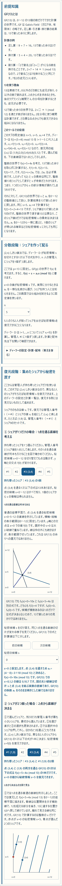
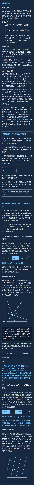
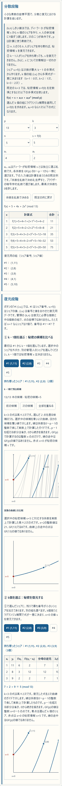
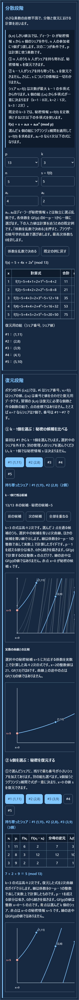
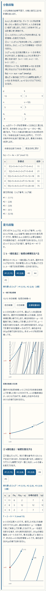
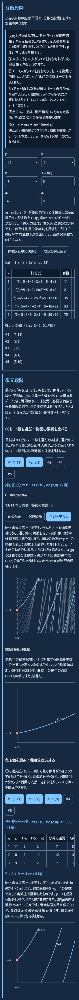
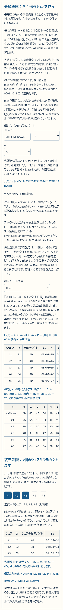
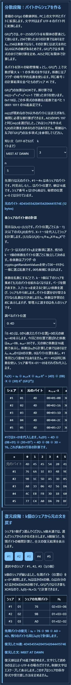
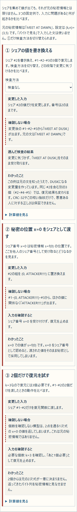
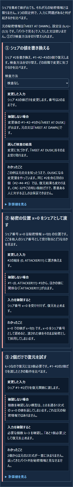

<!--
---
id: day123
slug: shamir-sharing-cipherlab
title: "ShamirSharing CipherLab"
subtitle_ja: "座標平面とバイトで追うシャミアの秘密分散"
subtitle_en: "Shamir secret sharing with coordinate planes and bytes"
description_ja: "GF(p)の座標平面とGF(2⁸)のバイト表で、シャミアの(k,n)しきい値法を学ぶ教材。"
description_en: "Explore Shamir (k,n) threshold sharing with coordinate planes, byte tables, and implementation pitfalls."
category_ja:
  - 現代暗号
  - 情報理論
category_en:
  - Modern Cryptography
  - Information Theory
difficulty: 3
tags:
  - shamir
  - secret-sharing
  - finite-field
  - lagrange-interpolation
repo_url: "https://github.com/ipusiron/shamir-sharing-cipherlab"
demo_url: "https://ipusiron.github.io/shamir-sharing-cipherlab/"
hub: true
---
-->

# ShamirSharing CipherLab - 座標平面とバイトで追うシャミアの秘密分散

[English](README.en.md)


[](https://ipusiron.github.io/shamir-sharing-cipherlab/)

**Day123 - 生成AIで作るセキュリティツール200**

ShamirSharing CipherLabは、Shamirの秘密分散を座標平面とバイト表で試す教材です。まず「(2, n)を可視化する」で1個と2個のシェアを比べ、次に「(k, n)を手で追う」で一般のしきい値法を計算します。「バイトで見る」は文字列をバイトに変換して分け、「確かめる」は不正な入力やシェアの変更を調べます。

ShamirとBlakleyは1979年に秘密分散方式を独立に提案しました。本ツールが扱うのは、Shamirの多項式による方式です。ラグランジュ補間はその復元計算に使います。Blakleyの幾何学的な方式は扱いません。

Shamirの`(k,n)`しきい値法では、秘密情報`s`から`n`個のシェアを作り、`n`人に1個ずつ渡します。次の二つが条件です。

① `n`人のうち`k`人がシェアを持ち寄れば、秘密情報`s`を復元できます。

② `k−1`人がシェアを持ち寄っても、`s`を復元できません。さらに、`s`についての情報は一切わかりません。係数を0も含めて一様に選ぶと、`k−1`個から見た秘密候補はすべて同じ確率で残ります。

「(2, n)を可視化する」と「(k, n)を手で追う」の`s`には架空の数を、「バイトで見る」の短い文には練習用の文を入力してください。実際に使っているパスワード、シードフレーズ、鍵の分割や保管には、この教材を使わないでください。シェアの書式、印刷、QR、保管の方法は扱いません。

---

## 🌐 デモページ

👉 **[ShamirSharing CipherLabを開く](https://ipusiron.github.io/shamir-sharing-cipherlab/)**

通常のブラウザーで開けます。HTMLファイルを`file://`で直接開いても動作します。計算と入力はブラウザー内で完結し、外部には送信しません。

---

## 📸 スクリーンショット

| 状態 | ライト | ダーク |
|---|---|---|
| (2, n)を可視化する |  |  |
| (k, n)を手で追う |  |  |
| k−1個の候補 |  |  |
| バイトで見る |  |  |
| 確かめる |  |  |

英語の同じ5状態は[English README](README.en.md)に掲載しています。
スクリーンショットのバイト表は撮影時の係数で計算した一例です。実際に「バイトで見る」を開くたび、乱数係数とシェア値は変わります。

## ✨ できること

| 段階 | 操作 | 見えること |
|---|---|---|
| (2, n)を可視化する | 1個のシェアから秘密候補を切り替え、2個目を加える | 1点を通る複数の直線と、2点から決まる1本の式 |
| (k, n)を手で追う | GF(p)で分散・復元し、k−1個の候補を重ねる | シェアの計算、ラグランジュ係数、秘密候補 |
| バイトで見る | UTF-8の短い文をGF(2⁸)で分け、k個から戻す | バイトごとの多項式、XOR、選択数に応じた復元計算 |
| 確かめる | 改ざん・x=0・足りない枚数の模型を比べる | 検査なし、CRC-32、秘密中の指紋の違い |

書籍と同じく、`D`をディーラー、`s`を秘密情報、`vᵢ=f(i)`を番号`i`のシェアと呼びます。`(k,n)`は、n個のシェアを作り、そのうち任意のk個以上で`s`を復元する設定です。`p`は計算に使う素数で、`p>max(s,n)`とします。多項式の次数は最大k−1で、k=1は0次、k=2は1次、k=3は2次です。既定の`k=3`では`f(x)=s+a₁x+a₂x² (mod p)`を使い、選んだ3点からラグランジュ補間で`s=f(0)`を求めます。

書籍でいうシェアは値`vᵢ`です。本ツールのボタン`#i (i,vᵢ)`では、`#i`がシェア番号、括弧内が復元に使う「番号と値」の組です。冒頭の`(k,n)`は復元に必要な個数と作る個数で、点の座標とは異なります。たとえば`n=7`ならシェアは7個で、番号は`#1`～`#7`です。

「分散段階」の表では、`f(i)`に各番号を代入した計算式・合計・`mod p`の結果を示します。その下に、復元用の組`(i,vᵢ)`を番号順に並べます。`n=7`なら`#1`～`#7`の7個を作り、係数や`p`を変えると結果も更新されます。

「(k, n)を手で追う」タブの既定例は`p=13, k=3, n=5, f(x)=5+4x+2x²`です。復元用の組は`(1,11), (2,8), (3,9), (4,1), (5,10)`です。`#1, #2, #3`から計算するラグランジュ係数は`(3,10,1)`、各項の寄与は`(7,2,9)`で、和を13で割った余りが秘密`5`です。2個だけなら13個の候補が残ります。

係数は0も許します。そのため多項式は「次数k−1以下」と書きます。`k=1`を選ぶと全員のシェアが秘密そのものになり、「分けていない（ただのコピー）」ことがわかります。

### (2, n)から始める理由

GF(13)は0〜12の13個の整数値を使う有限体です。足し算・引き算・掛け算の結果を13で割った余りに戻し、0以外の数で割るときは逆元を掛けます。13が素数なので、0以外の数には必ず逆元があります。「(2, n)を可視化する」では`p=13`に固定し、`f(x)=s+a₁x (mod 13)`を使います。タブ冒頭の「前提知識」で、整数の世界で計算したシェアとの違いを説明します。

導入タブは`p=13, n=5, s=5, a₁=4`で始まり、`f(x)=5+4x (mod 13)`からシェアを作ります。「分散段階」では、ディーラー`D`が`vᵢ=f(i)`を計算して各管理人へ渡します。折りたたみを開くと、`v₁=f(1)=(5+4×1) mod 13=9`から`v₅=f(5)=(5+4×5) mod 13=12`まで、計算と配布先を確認できます。

「復元段階」は、初期状態で管理人#3の組`(3,4)`を選んでいます。シェアそのものは値`v₃=4`です。復元では管理人番号`i`（＝`#i`）とシェア値`vᵢ`を組にして`(i,vᵢ)`と表します。たとえば`(1,9)`は管理人番号1（＝#1）とシェア9の組です。#3の1点だけなら、`s=0`として`a₁=10`と決めた別の式も通ります。候補`s=0～12`のどれにも式が1本ずつあり、係数を一様に選べば候補の確率は変わりません。管理人#1の`(1,9)`を加えると、式は`f(x)=5+4x (mod 13)`に決まり、`s=f(0)=5`を復元できます。

ディーラーの`s`と`a₁`は折りたたみ内で変更できます。参加者が1個のシェアだけを持つ場面では、これらを知らないものとして考えます。座標平面は0始まりで、横がシェア番号`x`、縦がシェア値`y`です。マウスを重ねると座標`(x,y)`が表示されます。

1個のシェアを考える図では、普通の座標平面に`(3,4)`を通る3本の直線を描きます。各直線とy軸の交点は`f(0)`、つまり秘密候補`s`で、図では`0・5・12`と異なります。これは1点だけでは直線が決まらないことを示す図です。

GF(13)でも`f₀(x)=10x`と`f₅(x)=5+4x`は別の式です。どちらも`f(3)=4`ですが、`f₀(0)=0`、`f₅(0)=5`です。候補が複数あるのは1点だけでは式が決まらないためです。秘密候補`s`を選ぶと、`a₁=(y−s)÷x (mod 13)`からその点を通る式を求めます。`s=0`なら`f(x)=10x (mod 13)`で、`x=0,1,2`を代入した値は`0,10,7`です。画面の直線は関係をつかむための図です。GF(13)で式を評価できるのは整数の`x=0～12`だけで、線上の途中の位置に有限体の値はありません。

## 📚 『暗号技術のすべて』を片手に試す

『暗号技術のすべて』9.2節（P652–661）を開きながら、数値例をツールへ入力できます。最初に(2,n)の一次式を試し、続いて一般の(k,n)でシェアの作成と補間を追います。書籍の(3,5)の例も再現できます。

| 本書 | ツールで試すこと |
|---|---|
| P652–654 | `(2,n)`の一次式を最初のタブで試す。1個のシェアでは13個の秘密候補が残り、2個では1個に決まる。ディーラー`D`がシェア`vᵢ=f(i)`を各管理人に渡す過程も確認する。 |
| P655–657 | 3点`(a,A),(b,B),(c,C)`の補間を、「(k, n)を手で追う」の`(xᵢ,yᵢ)`と`λᵢ(0)`に対応づける。2個だけ選んだときに残る候補と、3個選んだときの復元計算を比べる。 |
| P658–659 | 本書の数値例を入力する。`p=17, k=3, n=5, s=13, a₁=10, a₂=2`とすると、`f(1)…f(5)=8,7,10,0,11`。`#1, #3, #5`を選んで`s=13`に戻ることを確認する。 |
| P660–661 | 「確かめる」で、不正なシェアと検証の必要性を見る。本書のVSSなどの拡張は、このツールのCRCや指紋の模型とは機能が異なる。 |

ツールの初期値は操作しやすいGF(13)の別例です。本書の数値例を試した後は「既定の例に戻す」で戻せます。

## 📖 使い方

1. 「(2, n)を可視化する」の分散段階を開き、ディーラーが`v₁…vₙ`を計算して各管理人へ渡す流れを確認します。復元段階の①ではシェアを1個選び、同じ点を通る直線の切片を切り替えます。②で2個目を選ぶと、式と秘密が1つに決まります。
2. 「(k, n)を手で追う」では`p, k, n, s, a₁…`を設定し、分散段階の表で代入式と各シェアを読みます。係数は手で入力するか、「係数を乱数で決める」で選び直せます。
3. 復元段階の①で`k−1`個のシェアを選び、秘密候補を切り替えるか「全部を重ねる」を押します。②で`k`個選ぶと、ラグランジュ補間の表と`f(0)`が表示されます。整数の`x`で求めたGF(p)の値と、実数上の曲線のガイドを区別して読みます。
4. 「バイトで見る」ではUTF-8で32バイト以内の文を入力し、`2≤k≤n≤8`で分けます。バイト位置を選んで係数と各シェアの計算を確認します。復元段階では0個からシェアを選び、`k`個未満の式と、`k`個揃ったときの補間表を比べます。
5. 「確かめる」では、シェアの変更、`x=0`、枚数不足の固定例を見ます。改ざんのカードでは検査を切り替えます。3つのカードは固定の`MEET AT DAWN`を使い、「バイトで見る」に入力した文には連動しません。

画面右上の「?」には、操作手順、活用例、GF(2⁸)の掛け算の固定例、入力と保存の扱いをまとめました。しきい値法の根拠と出典は、ヘルプ内の「座学」を開いて読めます。

### 「バイトで見る」で増える処理

本書P652–661はGF(p)の数でShamir方式を説明します。「バイトで見る」は、その考え方をPC上の短い文字列へ広げる教材です。GF(2⁸)は256で割った余りの計算ではなく、AESと同じ既約多項式を使う有限体です。画面にも各段階の説明を置きました。

1. 入力した文をUTF-8へ変換します。日本語などは1文字が複数バイトになるため、上限は文字数ではなく32バイトです。
2. 各バイト位置`j`の元の値`sⱼ`から、別々の多項式`Fⱼ(X)`を作ります。係数は`crypto.getRandomValues`から各列で独立に選びます。同じ番号`i`で計算した値を全バイト分並べたものがシェア`#i`です。画面でバイト位置を選ぶと、その回の係数と`#1`〜`#n`の計算結果を追えます。
3. 復元段階でシェアを1個ずつ選びます。既定の`k=3`なら、先頭バイトの未知数は`s₀, a₁,₀, a₂,₀`の3個です。1個のシェアからは式が1本、2個からは2本しか得られず、`s₀`は00～FFのどれにもなれます。3個揃うと各シェア番号から`λᵢ(0)`を計算し、シェア値との積をXORして先頭バイトを戻します。同じ補間係数を残りのバイト位置にも適用します。
4. 復元結果をまず16進で表示します。正しいUTF-8なら文としても表示し、制御文字はエスケープします。文字表示だけで復元結果を判断しないためです。

GF(2⁸)では足し算がXORで、掛け算には既約多項式`z⁸+z⁴+z³+z+1`を使います。固定例`{57}×{13}={FE}`の8回の掛け算と、表示専用のlog/exp表の説明はヘルプにあります。この固定例は、画面で作るシェアの乱数係数とは連動しません。シェアのファイル形式や保管・受け渡しは、この教材の範囲に含めていません。

### 0x11Bとバイトごとの式

`(k,n)=(3,5)`なら、バイト位置`j`ごとに`Fⱼ(X)=sⱼ⊕a₁,ⱼX⊕a₂,ⱼX²`を作ります。`sⱼ`は元のバイト、`a₁,ⱼ`と`a₂,ⱼ`は独立に選んだ乱数です。`X=1,2,3,4,5`を代入した`Fⱼ(i)`が、各シェア`#i`の`j`列になります。`k=3`が`Fⱼ`の次数の上限を2にし、`n=5`が評価する番号の個数を5にします。画面の表は暗号学的乱数を毎回引き直すため、開くたびに値が変わります。

計算方法だけを示す固定例では、`s₀={4D}`、`a₁,₀={57}`、`a₂,₀={13}`とします。`#2`の列0は`X={02}`、`X²={04}`を代入し、`{57}·{02}={AE}`、`{13}·{04}={4C}`を求めて、`{4D}⊕{AE}⊕{4C}={AF}`です。`#4`なら`{57}·{04}={47}`、`{13}·{10}={2B}`なので`{4D}⊕{47}⊕{2B}={21}`です。ここに置いた係数は説明用で、画面が引いた乱数とは異なります。

この`Fⱼ(X)`と、バイトの掛け算に使う法多項式`m(z)=z⁸+z⁴+z³+z+1`は別の式です。`X`はシェア番号を代入する変数で、`z`は1バイトをビット列から多項式へ読み替えるための記号です。たとえばバイト`0x57`は`z⁶+z⁴+z²+z+1`を表します。`Fⱼ(2)`の`X²`や`a₂,ⱼX²`を計算する際に、バイト同士の積を`m(z)`で割った余りへ戻します。`Fⱼ(X)`全体を`m(z)`で割るわけではありません。

`m(z)`の係数が1の次数は8、4、3、1、0です。次数8から0までの係数を並べると`1 0001 1011₂`、16進数では`0x11B`です。8ビットの値を左へ1ビットずらして最上位ビットがあふれたときは、`z⁸≡z⁴+z³+z+1 (mod m)`を使います。この下位8ビットが`0x1B`で、実装の還元処理に現れます。

法多項式には8次の**既約多項式**を選びます。`m(z)`で割った余りの集合が256個の元を持ち、0以外の元に逆元ができるためです。逆元があれば、シェアの復元で使うラグランジュ補間の分母を割れます。8の素因数は2だけなので、`z²⁵⁶≡z (mod m)`と`gcd(m,z¹⁶−z)=1`の二条件で既約性を検証できます。GF(2)では引き算もXORなので、`z¹⁶ mod m=0x5E`から`z¹⁶−z=0x5C`となります。ユークリッド互除法の余りは`0x37→0x05→0x01`で、最大公約数は1です。

8次の既約多項式はほかにもあります。本ツールがこの式を採用した理由は、[NIST FIPS 197の4.2節](https://nvlpubs.nist.gov/nistpubs/FIPS/NIST.FIPS.197-upd1.pdf)で定めるAESのGF(2⁸)と同じ掛け算を示すためです。AESの暗号化手順をシェアの作成に使うという意味ではありません。

## 🔬 仕組みと限界

GF(p)では`λᵢ(0) = Πⱼ≠ᵢ xⱼ/(xⱼ−xᵢ)`、`s = Σᵢ λᵢ(0)yᵢ`です。GF(2⁸)でも同じ補間を行いますが、足し引きはXORです。バイトの掛け算と`0x11B`の関係は前節で説明しました。表示するlog/exp表の生成元`{03}`はSLIP-39の参照実装で使われ、{03}の位数255と{02}の位数51は付属テストでも検算します。

実データの分割・復元には、表引きをしない8回のシフトとマスクによる掛け算を使います。[CVE-2023-25000](https://osv.dev/vulnerability/GO-2023-1709)は表引きのタイミングが問題になった実例です。ただしJavaScriptの実行環境で定数時間は保証できません。教育用のブラウザー実装であり、実運用の秘密分散器ではありません。

CRC-32は書き写しの誤りを見つけられますが、書き換えた人がCRCを再計算すれば通ります。秘密に付けたSHA-256の先頭4バイトは、戻った値の不一致を高い確率で見つけますが、悪いシェアの持ち主を特定しません。改ざん者は元の秘密を知らないため、任意の文を狙って復元させることはできず、ずらす量だけを決められます。この模型で`DAWN→DUSK`を見せられるのは、観客に元の秘密が見えているためです。

座学の出典は画面の各節に一次資料・二次資料を分けて示しました。Shamirの原論文は *Communications of the ACM* 22(11), 612–613 (1979), [DOI:10.1145/359168.359176](https://doi.org/10.1145/359168.359176)です。Blakleyの原論文は *Safeguarding Cryptographic Keys*（1979）で、[本文](https://pages.cs.wisc.edu/~cs812-1/Blakley1979.pdf)を確認しました。ラグランジュ補間は[HAC 12.71](https://cacr.uwaterloo.ca/hac/about/chap12.pdf)と、IPUSIRON『暗号技術のすべて』9.2節（P652–661）をあわせて参照できます。Tompa & Wollの本文は未確認で、書誌の年・号は資料間で1988年1(2)と1989年1(3)に割れています。

## 🔄 Day070と先行例との関係

| 観点 | [Day070 VisualCryptography CipherLab](https://github.com/ipusiron/visual-cryptography-cipherlab) | Day123 ShamirSharing CipherLab |
|---|---|---|
| 方式 | Naor・Shamirの視覚暗号（1994） | Shamirのしきい値法（1979） |
| 秘密 | 白黒画像の画素 | GF(p)の数、GF(2⁸)のバイト |
| 戻し方 | 2枚を重ねて目で見る | ラグランジュ補間で計算する |
| 扱うしきい値 | (2,2)を体験 | (k,n)を変え、k−1枚の候補を描く |
| シェアの大きさ | 画素が広がり、重ねるとコントラストが落ちる | 秘密と同じ大きさ（理想的） |

| 観点 | 調べた範囲の先行例 | この教材で追加する体験 |
|---|---|---|
| 可視化 | 動画・スライド・Wolframの図 | 秘密候補を重ね、補間後の式と比べる |
| 手計算 | codex32のGF(32)用の紙の道具 | 小さなGF(p)で補間表を追い、GF(2⁸)へ移る |
| 落とし穴 | 多くの実装は拒否や検査を行う | わざと無防備な模型と守る実装を並べる |

先行例の調査は網羅的ではありません。Day070は画像、Day123は数とバイトで、別の方式を体験します。

## 🎯 ユースケース

このツールならではの使い方：

- 数学の授業：学習者が(1,11)(2,8)を固定し、13本の候補を重ねる。候補が1本も優先されない理由を目で追える。
- 有限体の入門：`f(x)=5+4x+2x²`の整数値`21,35`とGF(13)の値`8,9`を並べる。余りから秘密が漏れる場合と漏れない場合を比較できる。
- 実装レビューの演習：係数の抽選範囲に0を含める理由と、`x=0`をシェア番号として受け付けない理由を調べる。
- 謎解き・CTFの題材：作者が公開値だけの問題を作り、参加者が`λ=(3,10,1)`から秘密`5`を計算する。本物の認証情報は使わない。
- プログラミングの授業：2枚を素の実装へ渡すと`2DB1…`の誤ったバイトが出る例から、しきい値とUTF-8の検査を設計する。

ほかに、『暗号技術のすべて』9.2節（P652–661）の副読、Day070の視覚暗号との比較、[Day118 SHA-256 Byte Inspector](https://github.com/ipusiron/sha256-byte-inspector)で指紋の仕組みの学習、[Day029 OTP Animation](https://github.com/ipusiron/otp-animation)と情報理論的安全性を比べる教材にも使えます。

## 🔒 入力と実装上の注意

- 保存：言語と明暗のみ。入力した文や係数をlocalStorageやURLに置かない。
- 通信：アプリの計算は外部通信を行わず、`connect-src 'none'`のCSPを設定。
- 入力：UTF-8で32バイト、GF(p)の値は0以上p未満。IMEの変換中は再計算しない。
- 復元：本物の補間関数はx=0、重複x、k未満、長さ不一致を拒否。無防備な模型は別ファイルに分離。
- 限界：異なる分割から混ぜたシェアの正しさや、誰が改ざんしたかはこの教材だけでは証明しない。

## 🧪 テスト

Node.js 22以上で`npm test`を実行します。依存パッケージは不要です。GitHub Actionsでもpushとpull requestの両方で実行します。`python test/interface.browser.py`はPython Playwrightがある環境でChromium・Firefoxを使い、`file://`の操作と320/390/1280pxを検査します。

| 範囲 | 主な検査 |
|---|---|
| A GF(2⁸) | 65,536組の掛け算一致、FIPS 197の2例、逆元255個、生成元の位数 |
| B GF(p) | 既定の5シェア、3組のλ、13候補、係数の抽選範囲、整数値、k=1 |
| C 分割と補間 | 固定乱数の既知共有、10組すべての3-of-5復元、ランダム往復 |
| D 落とし穴 | 改ざん・CRC・指紋、x=0、k不足、固定ベクターの全項目 |
| E 静的・UI | CSP、保存項目、禁止API、日英辞書、SHA-256の原本一致、画面幅と操作 |

期待値は`test/vectors.json`を読み込みます。固定乱数はi番目のバイトが`(37·i+11) mod 256`です。これはテスト専用で、画面の分割には`crypto.getRandomValues`を使います。

## 📁 ディレクトリー構造

各行の`#`以降は役割です。作業用の`.work/`はGitに含めません。

```text
|-- .github/workflows/test.yml # Node 22のCI
|-- LICENSE # MITライセンス
|-- README.md # 日本語の説明とハブ用YAML
|-- README.en.md # 英語の説明
|-- package.json # テストコマンド
|-- index.html # 4タブの画面とCSP
|-- style.css # 座標平面と画面の配色・レイアウト
|-- messages.js # 日英の辞書
|-- app.js # DOM、復元表、候補図と実数曲線
|-- intro.js # (2,n)の一次式と秘密候補の直線図
|-- gf-core.js # 有限体と補間の純関数
|-- pitfalls.js # 無防備な実装の模型と検査
|-- sha256-core.js # Day118由来の指紋用SHA-256
|-- test/core.test.js # 既知値と計算のテスト
|-- test/structure.test.js # CSPと辞書などの静的テスト
|-- test/readme.test.js # 日英READMEとファイル一覧のテスト
|-- test/interface.browser.py # file://と画面操作のブラウザーテスト
|-- test/vectors.json # 参照実装から写した期待値
|-- assets/ja/light/hand.png # 日本語・ライトの手計算
|-- assets/ja/light/intro.png # 日本語・ライトの(2,n)導入
|-- assets/ja/light/bytes.png # 日本語・ライトのバイト表
|-- assets/ja/light/pitfalls.png # 日本語・ライトの落とし穴
|-- assets/ja/light/candidates.png # 日本語・ライトの候補
|-- assets/ja/dark/hand.png # 日本語・ダークの手計算
|-- assets/ja/dark/intro.png # 日本語・ダークの(2,n)導入
|-- assets/ja/dark/bytes.png # 日本語・ダークのバイト表
|-- assets/ja/dark/pitfalls.png # 日本語・ダークの落とし穴
|-- assets/ja/dark/candidates.png # 日本語・ダークの候補
|-- assets/en/light/hand.png # 英語・ライトの手計算
|-- assets/en/light/intro.png # 英語・ライトの(2,n)導入
|-- assets/en/light/bytes.png # 英語・ライトのバイト表
|-- assets/en/light/pitfalls.png # 英語・ライトの落とし穴
|-- assets/en/light/candidates.png # 英語・ライトの候補
|-- assets/en/dark/hand.png # 英語・ダークの手計算
|-- assets/en/dark/intro.png # 英語・ダークの(2,n)導入
|-- assets/en/dark/bytes.png # 英語・ダークのバイト表
|-- assets/en/dark/pitfalls.png # 英語・ダークの落とし穴
|-- assets/en/dark/candidates.png # 英語・ダークの候補
```

## 💻 動作環境

最近のChromium・Firefoxで確認しています。`file://`でも動作します。スクリーンショットとブラウザーテストにはPython Playwrightを使いました。アプリ本体は外部ライブラリー、WebAssembly、外部フォントを使いません。

## 📄 ライセンス

MIT Licenseです。`sha256-core.js`は同じ作者のDay118から、先頭のMIT表示を含めて同じバイト列で取り込みました。

---

## 🛠️ このツールについて

本ツールは、「生成AIで作るセキュリティツール200」プロジェクトの一環として開発されました。
このプロジェクトでは、AIの支援を活用しながら、セキュリティに関連するさまざまなツールを制作・公開しています。

🔗 [プロジェクトの案内](https://akademeia.info/?page_id=44607)
